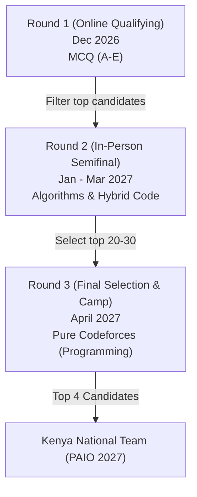

# Kenya Informatics Olympiad (KIO): Operational Plan & Selection Strategy

This document outlines the structure, timeline, roles, and strategic planning for the Kenya Informatics Olympiad (KIO) as we build towards selecting the national teams for the **2027 Pan-African Informatics Olympiad (PAIO)** and subsequent cycles.

---

## 1. Executive Summary & Core Objectives
As the host nation of an upcoming Pan-African Informatics Olympiad, establishing a robust, early-stage selection and training pipeline is critical. The primary goals are:
- **Build the 2027 National Team**: Run a rigorous three-round selection cycle to identify and train the representing team early.
- **Ensure Continuity**: Restrict eligibility to **Form 1, 2, and 3** students. Excluding Form 4 students ensures selected team members can represent Kenya in the following year without post-secondary school transition interruptions.
- **Establish a Sustainable Cycle**: Create a recurring timeline that accommodates funding variability, school terms, and aligns with partner programs (CEMASTEA, Kenya Mathematical Olympiad, and African Olympiad Academy).

---

## 2. Roster of Coaches & Directors
KIO is supported by a dedicated team of educators, administrators, and competitive programming coaches:

| Name | Role | Institution | Key Responsibilities |
| :--- | :--- | :--- | :--- |
| **Dr. James Katende** | Director | University of Nairobi | Academic oversight, institutional partnerships, university hosting logistics. |
| **Martin Mungai** | Director | CEMASTEA | Government/Ministry liaison, secondary school outreach, teacher coordinator. |
| **Dalton Omondi** | Head Coach | Kenyatta University | Curriculum design, problem setting (Rounds 2 & 3), camp coordinator. |
| **Angelo Opiyo** | Coach | JKUAT | Platform engineering, contest site management, training track instruction. |

---

## 3. Three-Round Selection Structure (2027 Cycle)

### Round 1: Online Open Qualifier
- **Timing**: Tentatively **December 2026** (to capture students after the November national exams when schools are closed, using dummy practice tests in the preceding weeks).
- **Format**: 2-hour online exam consisting of 20 multiple-choice questions (options A, B, C, D, E).
- **Focus**: Logic, pattern recognition, combinatorics, and basic computational thinking. No coding background required.
- **Goal**: Maximize participation and filter down to a manageable cohort of top performers.

### Round 2: In-Person Semifinal
- **Timing**: **January – March 2027** (One-day test at a central venue like University of Nairobi or CEMASTEA).
- **Format**: Written paper. Students are given algorithmic puzzles and must describe their solution.
- **Hybrid Marking Scheme**:
  - Focus is **algorithmic thinking**, not syntax compilation. 
  - **Full Marks**: Writing actual working code (e.g., Python, C++, Java).
  - **Partial Marks**: High-level pseudocode or step-by-step logic. This accommodates brilliant beginners who understand problem-solving but have not fully mastered programming syntax.
- **Goal**: Select the top 20–30 students for the Final Selection Camp.

### Round 3: Final Selection Camp
- **Timing**: **April 2027** (During the school holiday, aligned with the African Olympiad Academy camp timeline).
- **Format**: Live, pure competitive programming contests hosted on Codeforces (or similar online judge).
- **Focus**: Algorithmic correctness, execution speed, and edge-case handling. Programming proficiency is mandatory.
- **Goal**: Select the final 4 team members and reserves representing Kenya at PAIO 2027.

---

## 4. Timeline & Selection Options for Next Cycle (2028 Team)

We must navigate school terms, national holidays, and funding uncertainties. Below are the operational models for the next selection cycle (2028 Team):

### Contextual Benchmark: Kenyan Olympiad Ecosystem
- **Kenya Mathematical Olympiad (KMO)**: Round 1 (Feb/March), Round 2 (August), Round 3 (December).
- **African Olympiad Academy (AOA) Camp**: Annually in **April**.

### Scenario A: Full Funding Secured
If funds are secured, we can run KIO's cycle concurrently with the KMO cycle to share logistics, travel, and venue costs:
* **Round 1 (2028 Cycle)**: **February / March 2027** (Online, run concurrently with KMO Round 1).
* **Round 2 (2028 Cycle)**: **August 2027** (In-person, run concurrently with KMO Round 2).
* **Round 3 / Selection Camp (2028 Cycle)**: **December 2027** (Run concurrently with KMO Round 3).

### Scenario B: Limited/Uncertain Funding (Self-Sustaining Cycle)
If funding is constrained, we must decouple from KMO and run an independent, low-cost timeline. 

* **Option 1: April Overlap**
  - Launch the 2028 Round 1 in **April 2027** (while the 2027 cohort is in their Round 3 camp). 
  - *Pro*: Direct engagement and marketing during camp hype.
  - *Con*: High strain on the coaching team running a camp and an online qualifier simultaneously.
* **Option 2: Weekend In-School (Term 2) - RECOMMENDED**
  - Run Round 1 during a designated **weekend in Term 2 (late May/early June)** while students are in school.
  - *Pro*: Highly effective for school participation. Computers/internet are monitored by teachers in school labs, preventing cheating and increasing completion rates. 
  - *Con*: Requires active teacher coordination.
* **Option 3: Post-Camp / Pre-Camp Weekend**
  - Run the online qualifier a weekend before or after the April camp.

### Proposed Timeline Recommendation (Hybrid Approach)

| Phase | Target Date | Funding Scenario A (Funded) | Funding Scenario B (Self-Sustained) |
| :--- | :--- | :--- | :--- |
| **2027 Round 1** | December 2026 | Online | Online |
| **2027 Round 2** | Feb 2027 | In-person (UoN/CEMASTEA) | In-person (Local HUBS) |
| **2027 Round 3 / Camp** | April 2027 | 10-day physical camp | Physical camp or virtual intensive |
| **2028 Round 1** | **June 2027 (Term 2)** | In-School Weekend | In-School Weekend |
| **2028 Round 2** | **August 2027** | Physical (Co-run with KMO) | In-person (Local HUBS) |
| **2028 Round 3** | **Dec 2027** | physical camp | Virtual/Physical Exam Day |

---

## 5. Roles & Logistics Needed

To execute these timelines, KIO needs to structure roles and logistics clearly:

### Essential Roles
1. **Contest Coordinators (Angelo Opiyo & Dalton Omondi)**: Responsible for managing the testing platforms (Proctor AI, Codeforces, and dummy test sites).
2. **School Outreach Coordinator (Martin Mungai)**: Coordinates with CEMASTEA to onboard partner schools and ensure school computer labs are available for the Term 2 in-school rounds.
3. **Academic/Problem-Setting Committee**: Drafts the MCQ questions for Round 1 and grading rubrics for Round 2.
4. **Camp Director (Dr. James Katende)**: Manages boarding, meals, and safety during the April selection camp.

### Key Logistics
- **Platform Infrastructure**: Maintain the Proctor AI portal and set up test accounts.
- **Regional Exam Hubs**: For in-person Round 2, if travel budgets are tight, establish 3–4 regional university hubs (Nairobi, Kisumu, Mombasa) instead of one central venue to cut travel costs for students.
- **Sponsorship Packets**: Actively pitch to technology companies in Kenya for travel and accommodation funding for the PAIO team.

---

## 6. Challenges & Strategic Mitigation
1. **Internet & Device Accessibility**: In Scenario B (Term 2 school-weekend), some schools may have poor connectivity.
   - *Mitigation*: Provide downloadable offline exam files that auto-lock and can be uploaded once connectivity is restored, or extend the testing window to 48 hours.
2. **Transition from Theory to Code**: Bridging the gap between Round 2 (algorithms/pseudocode) and Round 3 (pure code) is difficult.
   - *Mitigation*: The training track (listed on the resources page) must actively offer free coding bootcamps for Round 2 qualifiers between March and April to prepare them for the Codeforces exam.
